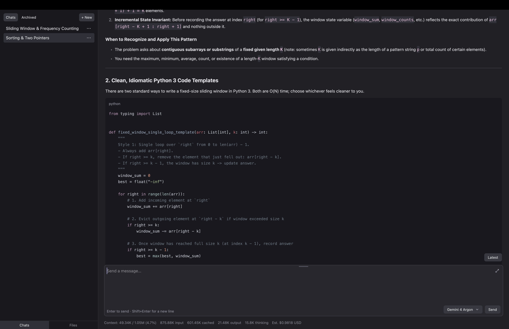

# Space

Space is a general-purpose agent harness built with [GPUI](https://gpui.rs/).



## Start

You need macOS, Xcode, Rust with rustup, and a Gemini API key. The Rust version is set in `rust-toolchain.toml`.

From the Space source folder, run:

```sh
export GEMINI_API_KEY="your-api-key"
cargo run --release --locked -- /path/to/project
```

Replace `your-api-key` with your key. Replace `/path/to/project` with an existing folder. Omit the path to use the current folder.

## Use

- Select **+ New** to start a chat.
- Enter a message. Press **Enter** to send it.
- Press **Shift+Enter** to add a new line.
- Select **Files** to view project files.

Space saves chats and settings in `.space/` in the project folder.

To add project instructions, put an `AGENTS.md` file in that folder.
